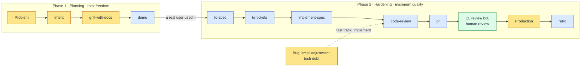

# MarsAI

**AI writes the code. You judge.**

MarsAI is the development workflow [V4 Company](https://v4company.com) uses to build with AI agents, published as open source: skills, agents and gates that take a change from the problem to production. Demo first, hardening after.

It runs in Claude Code, Codex, Cursor and OpenCode. The site explains every step, with an interactive map and the manifesto behind it: <https://marsai.v4company.com> ([em português](https://marsai.v4company.com/pt)).

> This is how V4 works, published as it is. Use it, fork it, adapt it. Whoever wants to contribute is welcome.

## Try it

Paste this into your coding agent. It installs MarsAI, briefly interviews you and helps adapt the skills to your project's architecture:

```text
Install MarsAI, V4 Company's development workflow, in this coding agent. Before starting work, briefly interview me about my role, whether the project is new or existing, the team size and our architecture standards. Read the repository and help adapt the skills to our architecture, reference code and checks.

Follow the instructions at https://marsai.v4company.com/install.md and the interview at https://marsai.v4company.com/onboarding.md. Ask before touching anything outside the agent's own configuration.
```

Or do it by hand:

```bash
# The wizard asks where to install: Claude Code, Codex, Cursor, OpenCode
npx --yes github:V4-Company/marsai-oss

# Claude Code only. The dev plugin brings marsai-core with it
claude plugin marketplace add V4-Company/marsai-oss
claude plugin install marsai-dev@marsai-oss
```

Then open a new session and type `/marsai-core:using-marsai` to complete the brief setup interview. It reuses your existing architecture and Standards, records the agreed setup with your permission, and points you to `/marsai-core:marsai-mode`. Later sessions reuse that setup. Options, update and removal: [docs/INSTALL.md](docs/INSTALL.md).

## The Home Repo thesis (how V4 runs it today)

At V4, about 40 people work across 80+ repositories. An agent started inside one product repository is blind to the rest of the architecture, and the skills and rules copied into each repository drift apart.

So V4 stopped installing plugins machine by machine. Inspired by Matt Pocock's [The Home Repo Pattern](https://www.aihero.dev/the-home-repo-pattern), every agent session at V4 starts in one central Home Repo, Home MarsAI. It holds a pointer to every repository, a living wiki of the system, V4's coding Standards, and MarsAI's skills right in `.claude/` (and `.agents/skills` for Codex), so a `git pull` updates the whole team with no installer. The decision is [ADR 0019](docs/adr/0019-sessions-start-in-the-home-repo.md).

Two ways in:

1. **Start fast** (one repository, or just you trying it): install from `V4-Company/marsai-oss` as plugins or with the CLI, as above. It takes a minute.
2. **Scale to a multi-repo team** (what V4 does): run `/marsai-core:home-repo`, included in `marsai-core`, to set up your team's Home Repo, with the pointers, a wiki, your Standards and your skills in `.claude/`, updated with `git pull`. MarsAI itself comes in through the plugins or, as at V4, copied into the same `.claude/` ([LAYOUT.md](plugins/marsai-core/skills/home-repo/LAYOUT.md)).

## The flow

A feature goes through two phases. In the first, total freedom to find out whether the idea is worth building. In the second, maximum quality, only for what proved its value. At each of the seven gates a person decides whether the work moves on.



| Gate | Question | Who decides |
| --- | --- | --- |
| G0 | Is the problem accepted? | The PM or tech lead of the area |
| G1 | Is the intent approved? | The PM, together with the stakeholder when there is one |
| G2 | Ready for the demo? | The developer who owns it, with the PM |
| G3 | Does the demo fulfill the intent? | The PM and the stakeholder, together, from real use |
| G4 | Is the technical plan approved? | The tech lead, in a session of up to 30 minutes with the PM and the developer responsible |
| G5 | Is the pull request ready? | Bots first, then a person who took part in the refinement session, when the delivery had one; a person reads every pull request, at the depth the risk asks for |
| G6 | Delivered for real? | Whoever owns the area |

The demo is a first version that works, used by a real user. In order of preference it runs in production behind a feature flag for selected users, with explicit approval, protected data and rollback; in development, with the user using it; or outside the codebase, as a last resort. Once value is proven, the spec cuts the v1, the technical plan is agreed down to the program design and hardening prepares its general release. A demo can also send the work back to the grill, or end the idea. The reasons are in [the manifesto](https://marsai.v4company.com/manifesto) and in the [decision records](docs/adr/).

## What is inside

| Plugin | What it holds |
| --- | --- |
| `marsai-core` | The single way into any work (`marsai-mode`), the map of the flow (`using-marsai`), the team's Home Repo (`home-repo`), the grill that records the glossary and the decisions (`grill-with-docs`), `wayfinder`, `handoff`, `retro`, commits and pull requests, and the guard hook for commits and pull requests |
| `marsai-dev` | The code flow: `demo`, `prototype`, `to-spec`, `to-tickets`, `implement-spec`, `implement`, `tdd`, `code-review`, and the implementer and reviewer agents |
| `marsai-extras` (optional) | Matt Pocock's `teach`, `research`, general `grill-me` and `writing-for-agents`, plus `marsai-diagram`, adapted from Cathryn Lavery, `in-your-own-words`, adapted from Lauren Tan, and `sol-loop`, `full-send` and `full-stop`, adapted from Theo Browne; installed only when selected |

Optional extras: `npx --yes github:V4-Company/marsai-oss install --group extras`, or `claude plugin install marsai-extras@marsai-oss` with the marketplace already registered. [Skills and invocation permissions](https://marsai.v4company.com/skills).

| Step | Skill | What it does |
| --- | --- | --- |
| Start | `/marsai-core:marsai-mode` | Say what you want in one sentence: it sizes the work, keeps the path as a checklist and leads you to the end, stopping at each gate |
| | `/marsai-core:home-repo` | For a team with several repositories: one repository where every session starts, with a pointer to each of the others, the shared docs, a wiki and the tools |
| Plan | `/marsai-core:grill-with-docs` | The agent interviews, fetches the facts and recommends; you decide. The glossary and the ADRs are written as you talk |
| | `/marsai-core:wayfinder` | When the grill outgrows one conversation: a decision map, one question per session |
| Prove | `/marsai-dev:demo` | The feature working on a demo branch, in the hands of a user |
| | `/marsai-dev:prototype` | Throwaway code for one design question: a rule, a screen, an exchange of events |
| Specify | `/marsai-dev:to-spec` | Cuts the v1, reads the current code and publishes the spec in the parent issue |
| | `/marsai-dev:to-tickets` | Cuts the spec into vertical slices, with what blocks what |
| Build | `/marsai-dev:implement-spec` | One implementer per slice, test first, one pull request per repository or one per slice when the whole would be too large to read well |
| | `/marsai-dev:implement` | The fast track: one slice, a bug, a small adjustment |
| Review | `/marsai-dev:code-review` | The reviewer applies the Standards, fixes the diff and commits |
| Ship | `/marsai-core:pr`, `marsai-core:babysit-pr` | A pull request with evidence and merge danger, followed until it is ready |
| Learn | `/marsai-core:retro` | The mistake that repeats becomes a check or a Standard |

Three design rules shape every file:

- **Standards are applied at review, not at implementation** ([ADR 0001](docs/adr/0001-standards-at-review-not-at-implementation.md)). The implementer makes the ticket work; the reviewer reads the rules in full and fixes the diff.
- **The person plans; the agent interviews** ([ADR 0003](docs/adr/0003-the-person-plans.md)). No skill hands a design decision to a planning agent.
- **Quality before token cost** ([ADR 0009](docs/adr/0009-quality-before-token-cost.md)). The most capable model at every step, and subagents whenever they keep the context clean or add a verification.

The skills are written in English and the agent answers in your language ([ADR 0011](docs/adr/0011-skills-in-english-answers-in-the-persons-language.md)).

## Make it yours

MarsAI carries V4's choices. You can use it as it is, and it works better once adapted.

| What is V4's | Where it shows | How to swap it |
| --- | --- | --- |
| Linear as the tracker | `to-spec`, `to-tickets`, `implement-spec`, `wayfinder` | The skills call the tools of the Linear MCP. In a fork, replace them with your tracker's |
| A review bot on every PR (at V4, Hermes, built in-house) | `babysit-pr`, the predicted score in `code-review` | Plug in CodeRabbit, Greptile, GitHub Copilot Review or your own bot, or none: the other brakes still hold |
| SonarQube in CI | `babysit-pr`, `retro` | Any static analysis that runs on the pull request |
| Linear history | The guard hook blocks merge commits | Set `MARSAI_LINEAR_HISTORY=off` in a repository that merges |
| The Standards | `code-review` | V4's are private. Yours go in your Home Repo's `.claude/` when you keep one, otherwise in a team pack |

Your own skills go in your Home Repo's `.claude/` when you keep one (see above), or in a **team pack** when you do not: a plugin of your own that depends on `marsai-dev`. Either way, the flow finds the pieces by how their description starts:

- a skill whose description starts with `Standards extension:` lists your rules files, per stack, and the review loads it;
- a skill whose description starts with `Implementation guide:` tells the implementer what your repositories share: the generator, the reference code, the stack;
- an agent whose description names your repositories is picked as the implementer for them;
- a hook holds the guards that are yours alone.

When your process differs from ours, fork the repository and change the skills themselves. More in [Make it yours](https://marsai.v4company.com/make-it-yours).

## Contributing

Issues and pull requests are welcome. [CONTRIBUTING.md](CONTRIBUTING.md) says how to write a skill and how to test a change. V4 maintains the repository and decides what goes in; what is specific to one team fits better in a team pack or in a fork.

Security reports: [SECURITY.md](SECURITY.md).

## Structure

```
.claude-plugin/marketplace.json   the marketplace: which plugins exist
plugins/marsai-core/              skills, commands and the guard hook everyone shares
plugins/marsai-dev/               the code flow: skills, agents, commands
cli/                              the installer for Claude Code, Codex, Cursor and OpenCode
site/                             the site: map, manifesto, one page per skill
docs/adr/                         the decisions behind the design
CONTEXT.md                        the glossary, in English and in Brazilian Portuguese
```

## Credits and license

The flow follows the design of [Matt Pocock's skills](https://github.com/mattpocock/skills) (MIT): several skills were copied and adapted, and keep their original names so his videos and docs still apply. The repository started as an adaptation of Ring, by Lerian Studio (Apache 2.0), whose original repository is no longer public. Details in [NOTICE](NOTICE) and in each plugin's `THIRD-PARTY-NOTICES.md`.

MarsAI is licensed under the [Apache License 2.0](LICENSE).
