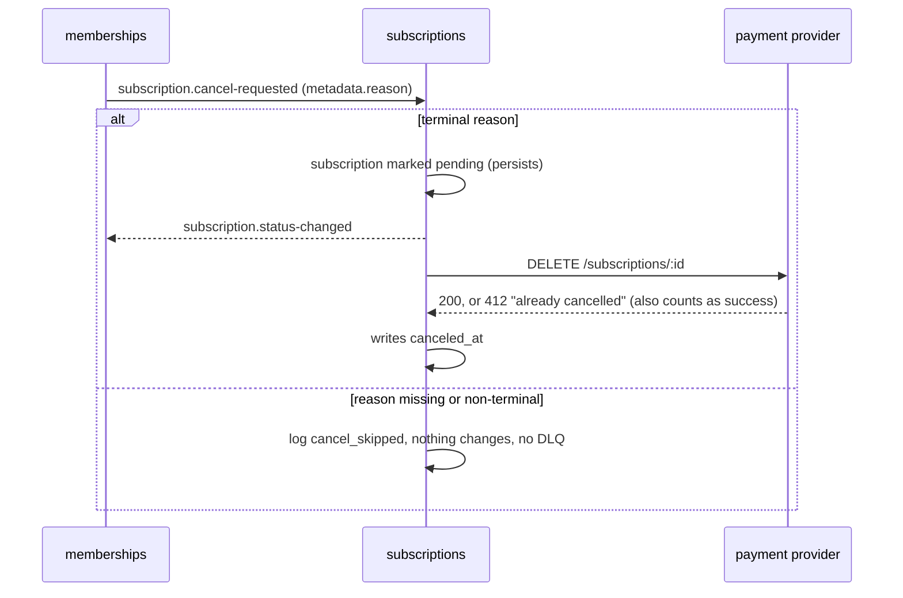
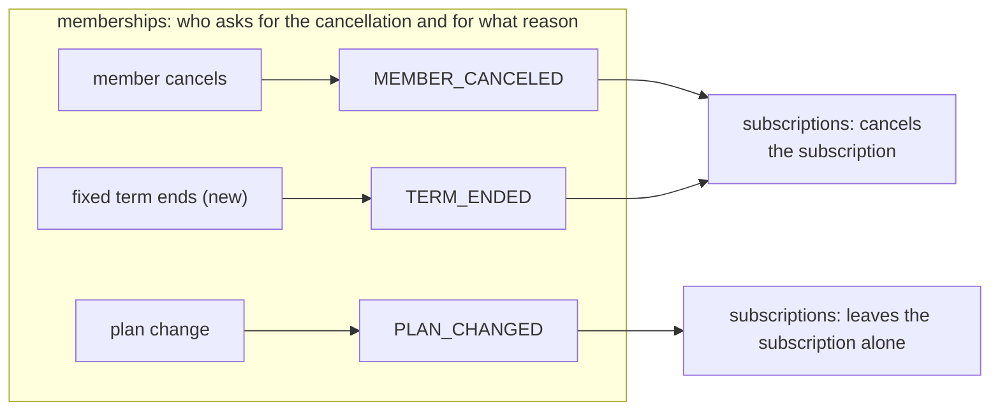
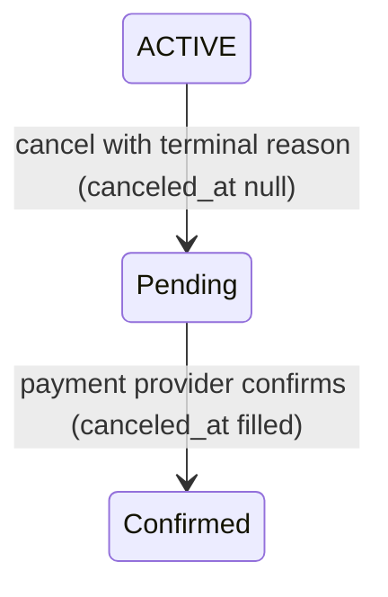

# A PR body for people who do not read

A body in "## Problem / ## Solution / ## Risk", with six-line bullets and a history of decisions, does not get read. This format is read in one minute and says what the reviewer needs in order to decide.

## The reader

Write for an engineer on the team who:

- **will not read**: glances at it, looks for the practical effect and decides whether to open the diff;
- **has no context**: does not know what the issue, the call, the ADR or the previous PR is; each internal acronym needs half a sentence of explanation or stays out;
- **has no time**: wants to know in one sentence what changes in production, what does not change, where to look first and how to deploy.

Consequences: the "why" fits on one line; the story of how the decision was reached stays out; what only matters to whoever will maintain the code goes into `<details>`.

## Structure (in this order)

~~~markdown
**In one sentence:** <what starts to happen in production and why it matters>.

**Why:** <one line, only if the opening sentence is not enough>.

```mermaid
<diagram, only when the flow explains better than text; or another view, in its own block>
```

**What changes**
- <up to six bullets; each with at most two sentences; verb in the present tense>

**What does not change:** <one or two sentences that reassure the reviewer>.

**Where to look first**
- `path/to/File.ts`: <the method or the part that matters>
- `test/.../spec.ts` (<why read it: "reads like the specification", "case X">)

**Evidence**
- **Before:** <screenshot, output or failing test that shows the old behaviour>
- **After:** <screenshot, output or passing test that shows the new one>

**Deploy:** <order between services, migration, rollback>. On one line.
**Tests:** <gates and concrete counts>. On one line.
**Size and design:** <lines changed; above about 400, that the delivery was split by slice or why it was not. With a technical refinement, that the code follows it, or the link to the approved change>. On one line.
**Stack / Related:** <links to the PRs, with the current one in bold>.

**Merge danger**
- **Door:** <two-way or one-way>. <the reason, in half a sentence>
- **Blast radius:** <local, service, between services or customer>. <what else can break if it goes wrong>

<details>
<summary>Risks and side effects</summary>
- <what can go wrong, races, pre-existing gaps, recorded debts>
</details>

<details>
<summary>Details for whoever wants them</summary>
- <method names, conventions, milestones, renames, ADRs>
</details>
~~~

Sections with no content are left out. A pure refactor may have no "Risks"; a one-line PR may have no diagram and no `<details>`.

## Writing rules

- **The opening is the effect, not the implementation.** "Cancelling a membership now cancels the subscription at the payment provider. Today that request dies in the DLQ and the subscription stays alive" says more than "adds reason to the event and a gate in the use case".
- **One bullet, one idea, at most two sentences.** If it needed a semicolon, it is two bullets or it is detail.
- **Code names only when the reader has to go there.** One per sentence; the rest in words. `metadata.reason` goes in because the reviewer will look for it; `markSubscriptionsPending` goes into the `<details>`.
- **Explain the acronym the first time** or swap it for words: "DLQ (the queue of messages that failed)" or "dies in the error queue".
- **"What does not change" is required** when the PR touches an existing flow. It is what lets the reviewer relax.
- **Numbers only when they decide something:** test counts, the number of subscriptions affected. No "1001 lines" unless that is the argument.
- **Deploy on one line**, with the order between services when there is one ("subscriptions before memberships") and what not to do ("do not revert X with Y live").
- **Risks go into `<details>`.** What changes the merge decision is already in the Merge danger.
- **No `##` headings** in the main body; bold at the start of the line does the job. `<details>` is the only collapsed block.
- **The language the repository already uses** in the body and in the title; code, commits and test names stay as they are.
- **Do not narrate the review**: "mutation review, 19 of 19 killed" fits in Tests; the list of findings does not.

## Evidence

Show that the change works, with a before and an after.

- **Visual change**: a screenshot of the before and of the after.
- **Any other**: something that was run. The test that failed and now passes, the command output, the e2e result with the data used.

Only what you saw run goes in. The Tests line is for the gates and the counts.

## Merge danger

It tells the reviewer how much attention the PR asks for. It stays visible, outside `<details>`, and is the last thing in the main body.

- **Two-way door**: the merge can be reverted and the previous state restored with no loss. This is the case for most PRs.
- **One-way door**: reverting the code does not undo the effect. A migration that deletes or transforms data, an email already sent or a charge already made, a published event that another service has already consumed, a contract a customer comes to depend on. A small change can be one-way: assess the effect, not the size of the diff.
- **Blast radius**: what else can break if the change goes wrong, and how serious it is. One word for the reach (local, service, between services, customer) and one sentence with the consequence. When the change touches an event or a contract, the event catalog says who consumes it: consult it before writing "local".

When in doubt between the two doors, declare one-way and give the reason. The section guides the review; the team's approval rule stays the same.

## Diagrams

Use a diagram when the flow, the decision or the mapping is the point of the PR. One per PR is usually enough; two when there is a flow and a state. Choose by the kind of thing that needs to be seen:

| The point of the PR is… | Diagram | Example |
|---|---|---|
| an exchange of messages between services or with an external provider | `sequenceDiagram` with `alt/else` for the branch that changes | memberships → subscriptions → payment provider, branch "terminal reason" × "non-terminal" |
| a decision with branches (what happens in each case) | `flowchart TD` with diamonds `{ }` | `cancel({ reason })`: still in trial? paid subscription? terminal reason? |
| a life cycle with a new intermediate state | `stateDiagram-v2` | subscription ACTIVE → pending → confirmed |
| structure before × after (extraction, split, rename) | `flowchart LR` with two `subgraph` blocks | a 1000-line class → two classes + config |
| origin → reason → effect (who sends what and what happens) | `flowchart LR` with one `subgraph` of origins and two effect nodes | seven cancellation reasons → "cancels the subscription" × "leaves it alone" |

Syntax rules that GitHub accepts (it cannot be validated offline; an error becomes an "Unable to render" box, so keep it simple):

- Labels in quotes whenever they have parentheses, commas, colons, accents or `<br/>`: `A["text (x), y"]`, `B{"question?"}`.
- A line break inside the node is `<br/>`.
- No loose `|`, `;`, `{ }` or `[ ]` inside a label; in `sequenceDiagram` messages use `/route/:id`, not `{id}`.
- Arrows: `-->` (flow), `-- yes -->` (label on the edge), `->>` and `-->>` (sequence).
- At most about twelve nodes; beyond that, the diagram has become documentation, not a summary.
- `subgraph id["Title"]` to name it; an edge between subgraphs (`before --> after`) works in `flowchart`.
- `stateDiagram-v2`: `A --> B: label` with free text; no `<br/>` in the label.

Templates that have already rendered well:







## Other views

Not every change is a flow between services. Choose the smallest view that makes the point clear, and put each one next to the text it supports.

- **Pseudocode** for logic or an algorithm. In diff format when the point is what changed:

  ```diff
   on cancelling the subscription
  -  requires status TRIAL
  +  if it is paid and the reason ends the membership
  +    marks the subscription as pending
  +    cancels at the provider
     publishes status-changed
  ```

- **Call tree** for the execution path:

  ```text
  CancelSubscription
    Subscription.cancel(reason)
    repository.save
    eventBus.publish
    provider.cancelRecurrence      # new
  ```

- **File tree**, shallow, for a refactor or for the responsibility of folders:

  ```diff
   src/providers/
  -└── PaymentProvider.ts
  +├── PaymentProvider.ts      # one-off charges
  +└── RecurrenceProvider.ts   # subscriptions
  ```

- **Component tree** for a screen, with the state and the boundaries that matter.

One or two views per PR. Show the whole block only when almost everything is new.

## Verification

After publishing, read the result with `gh pr view <n> --json body` and check: a one-sentence opening, up to six bullets, no `##`, evidence with before and after, merge danger present, diagrams with labels in quotes. `gh` accepts an empty or truncated body without complaining.

## Complete example (illustrative: a fictional payments service, APP-123)

~~~markdown
**In one sentence:** cancelling a membership, or reaching the end of a fixed-term plan, now cancels the subscription at the payment provider. Today that request dies in the DLQ and the subscription stays alive, ready to charge again.

```mermaid
sequenceDiagram
  ... (the sequence diagram above)
```

**What changes**
- Memberships now sends the reason in `metadata.reason`. Only three reasons end the subscription.
- If the payment provider fails on the `DELETE`, nothing goes to the DLQ: the subscription stays marked as pending and the `DELETE` is redone on the subscription's next activity or in a replay.
- The same event arriving twice returns `ALREADY_CANCELED` and does not make a second `DELETE`.
- The handler no longer sends expected outcomes to the DLQ (subscription not found, not cancellable, non-terminal reason, already cancelled). An infrastructure error still goes there.

**What does not change:** a subscription still in `TRIAL` cancels as it does today. The `PATCH /subscriptions/:id/cancel` route still returns 400 in the same cases.

**Where to look first**
- `src/usecases/CancelSubscription.ts` (persists, publishes, provider in `finally`)
- `test/cancel-requested.spec.ts` (12 cases, reads like the specification)

**Deploy:** **subscriptions before memberships.** This PR tolerates an event with no `reason`. No migration.
**Evidence**
- **Before:** cancelling a membership with a paid cycle threw `SubscriptionNotCancellableError` and the message went to the DLQ.
- **After:** local e2e across the three services with sandbox subscriptions: the cancelled membership cancelled its two live subscriptions; redelivery with no second `DELETE`; DLQs empty.

**Tests:** typecheck, lint, 312 unit and 41 integration tests green.
**Stack:** #12 → #13 → **#14 (this one)** → #15.

**Merge danger**
- **Door:** one-way. A subscription cancelled at the payment provider stays cancelled even if the PR is reverted.
- **Blast radius:** between services. A reason classified wrongly would cancel the subscription of an active membership.

<details>
<summary>Monitors before the production deploy</summary>
- Stuck pending cancellations: `SELECT ... WHERE canceled_at IS NULL AND updated_at < now() - interval '1 day'`.
- Log entries with `PROVIDER_CANCEL_FAILED`.
</details>
~~~

## Anti-patterns (what the old body did)

| Before | Why it does not work | Now |
|---|---|---|
| `## Problem` with four lines of history ("decision 6 of the call, APP-120…") | the reader does not know what the call or the issue is | one sentence with the practical effect; the reference goes into `<details>` |
| a six-line bullet with four method names | nobody finishes reading it | one bullet per idea, code names only in "Where to look" |
| "Risk" listing technical debts in the middle of the body | hides the risk that matters | the decisive risk in the body, the rest in `<details>` |
| no diagram in a flow between three services | the reviewer builds the flow in their head, or does not review | `sequenceDiagram` with the branch that changes |
| "Tests: green" | does not say how much was covered | counts and the e2e on one line |
